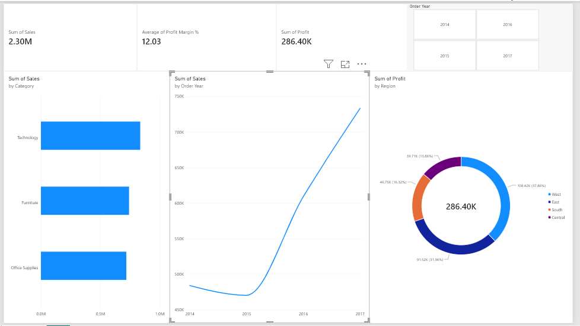

# Superstore Retail Sales Analytics Pipeline & Power BI Dashboard

End-to-end data analytics project cleaning 9,994+ retail transactions using Python (Pandas) and building an interactive executive dashboard in Power BI.

## Key Business Insights
- **Total Sales:** $2.30M across 3 product categories (2014–2017)
- **Total Profit:** $286.40K with an average profit margin of **12.03%**
- **Top Category:** Technology leads overall revenue generation
- **Top Region:** West region contributes the highest profit share (**37.86%**), followed by East (**31.96%**)

## Files Included
1. **`Sample_Superstore.ipynb`** — Data inspection, `latin1` encoding handling, datetime parsing, and feature engineering (`Order Year`, `Order Month`, `Shipping Days`, `Profit Margin %`).
2. **`cleaned_superstore.csv`** — Processed dataset ready for BI reporting.
3. **`Superstore_Sales_Dashboard.pbix`** — Interactive Power BI Desktop report with KPI cards, Category Sales bar chart, Multi-year trend line, Region Profit donut chart, and Year tile slicers.
4. **`Superstore_Sales_Dashboard.pdf`** — Exported executive report for quick viewing.# Superstore Retail Sales Analytics Pipeline & Power BI Dashboard

End-to-end data analytics project cleaning 9,994+ retail transactions using Python (Pandas) and building an interactive executive dashboard in Power BI.

## Key Business Insights
- **Total Sales:** $2.30M across 3 product categories (2014–2017)
- **Total Profit:** $286.40K with an average profit margin of **12.03%**
- **Top Category:** Technology leads overall revenue generation
- **Top Region:** West region contributes the highest profit share (**37.86%**), followed by East (**31.96%**)

## Files Included
1. **`Sample_Superstore.ipynb`** — Data inspection, `latin1` encoding handling, datetime parsing, and feature engineering (`Order Year`, `Order Month`, `Shipping Days`, `Profit Margin %`).
2. **`cleaned_superstore.csv`** — Processed dataset ready for BI reporting.
3. **`Superstore_Sales_Dashboard.pbix`** — Interactive Power BI Desktop report with KPI cards, Category Sales bar chart, Multi-year trend line, Region Profit donut chart, and Year tile slicers.
4. **`Superstore_Sales_Dashboard.pdf`** — Exported executive report for quick viewing.
